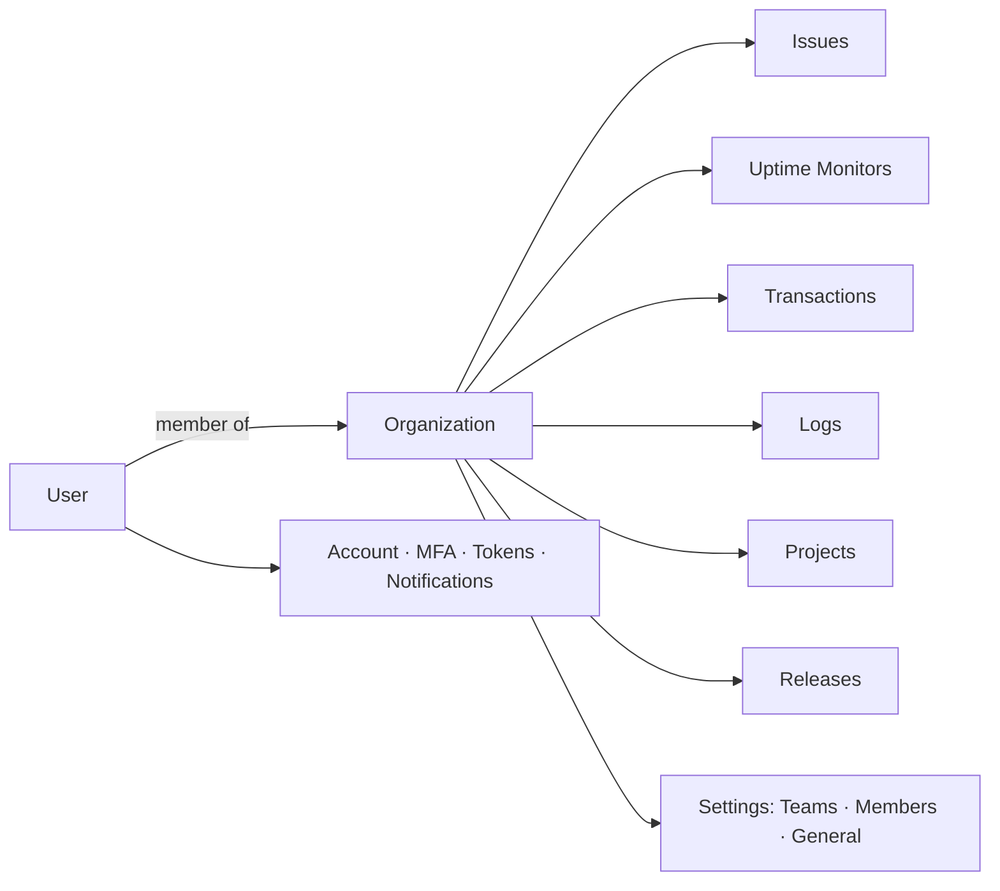
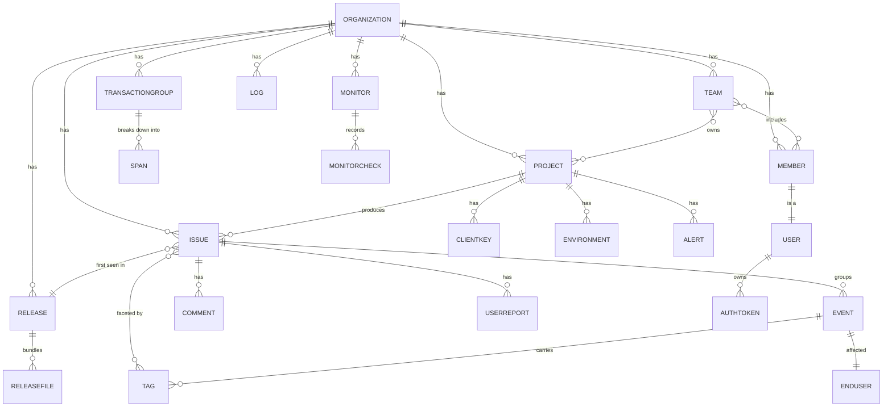

# GlitchTip through an Object-Oriented UX lens

*A design-system case study. How I reframed a component-first UI refactor as an
object-first system — and what that reveals.*

---

## Why this document exists

The [detail-page + settings design-system sweep](../../BREAKUP.md) unified how
GlitchTip's pages are built: two header tiers, uppercase eyebrow section headers,
monospace identifiers, an 8px spacing grid, one empty-state component. That work
was **component-first** — it started from "these pages use inconsistent cards and
titles" and standardized the parts.

This document does the opposite. It steps back and asks the **Object-Oriented UX**
question:

> *What are the **things** users actually think about in GlitchTip, and does the
> interface represent each of those things consistently everywhere it appears?*

People don't think in screens or features — they think in **objects**. On
Instagram it's *posts, profiles, reels*. In GlitchTip it's *issues, events,
monitors, releases, projects, teams*. When an interface mirrors the objects in a
user's head and the relationships between them, it feels inevitable: you always
know where you are, what you're looking at, and where a thing will take you.

The framework here is **OOUX** and Sophia Prater's **ORCA** process, which factors
a system into four things:

- **O**bjects — the nouns users care about
- **R**elationships — how objects connect (*has-a*, *is-a*, *part-of*)
- **C**TAs — the operations (verbs) users perform on each object
- **A**ttributes — the fields/values each object carries

The payoff for a design system: once the objects are named, the components stop
being generic ("a card", "a table") and become an **object-representation
vocabulary** — *this is how an Issue looks as a list row, as a detail header, as a
reference inside another object, as an empty state.* Consistency stops being a
matter of taste and becomes a property of the model.

---

## 1. The system shape

Almost everything in GlitchTip hangs off one root object — the **Organization**.
The account/profile objects are the exception; they belong to the **User** and sit
outside the org tree.

The left nav is, in effect, a list of the org's **object collections**. That's a
good OOUX starting sign: navigation organized by object, not by feature.

---

## 2. Object inventory

The domain objects, pulled from the API schema and interface files
(`src/app/api/**/*.interfaces.ts`, `src/app/issues/interfaces.ts`,
`src/app/api/api-schema.d.ts`). "Views" = does this object get a list, a detail,
or only appear nested inside another object.

| Object | One-liner | Key attributes (shown in UI) | Views |
|---|---|---|---|
| **Organization** | The tenant everything hangs off | name, slug, dateCreated | Detail (General settings); no list (nav switcher) |
| **Project** | A codebase that sends events | name, slug, platform, isMember, DSN keys | List **(cards)** + Detail (settings) |
| **Team** | A group that owns projects & members | slug, memberCount, dateCreated | List + Detail (tabs) |
| **Member** | A user *in an org role* | email, role/roleName, dateCreated, isOwner, teams | List + Detail |
| **Issue** | A deduplicated group of errors | title (type + culprit), level, status, count, userCount, firstSeen/lastSeen, firstRelease, shortId, tags | List + Detail |
| **Event** | One occurrence of an issue | id, dateCreated, exception chain, entries, contexts, sdk, tags, user | **No list** — nested in Issue; prev/next nav |
| **Tag** | A key/value facet of events | key, value, share % | **Part-of** Issue/Event (concentration rows) |
| **TransactionGroup** | A rolled-up transaction | transaction, op, method, count, avgDuration, p50/p95, errorRate | List + Detail |
| **Span** | A unit of work inside a transaction | op, description, count, avg, p95, totalTime | **Part-of** TransactionGroup |
| **Release** | A tagged version of code | version, ref, dateReleased, commitCount, deployCount, projects | List + Detail |
| **ReleaseFile** | An artifact in a release | name, size, sha1, dateCreated | **Part-of** Release (table) |
| **Monitor** | An uptime check target | name, url, type, interval, isUp, lastChange | List + Detail |
| **MonitorCheck** | One probe result | isUp, startCheck, reason, responseTime | **Part-of** Monitor (history strip) |
| **Log** | A structured log line | body, severity, timestamp, service, traceID/spanID | **List only** — no detail |
| **Alert** | A project notification rule | name, quantity, timespan, recipients, uptime trigger | **Part-of** Project |
| **Environment** | A deploy target / filter dim. | name, isHidden | **Part-of** Project; cross-cutting filter |
| **Comment / UserReport** | Human notes on an issue | text, user, dateCreated | **Part-of** Issue (tabs) |
| **ClientKey (DSN)** | The credential wiring a project | dsn.public, dsn.security | **Part-of** Project |
| **AuthToken** | A personal API credential | label, token, scopes | List (under Profile) |

Note the three flavors of "person": **User** (the account/self), **Member** (that
user *in an org role*), and **EndUser** (the person captured *inside an Event*).
Same human, three objects — flagged in §6.

---

## 3. Relationships — the object map

*has-a* (`1..*`), *part-of*, and *is-a*, derived from the routes and which detail
page links to which.

Reading it back in plain language — *an Organization has many Projects; a Project
produces many Issues; an Issue groups many Events; an Event affected one EndUser;
a Monitor records many Checks; a Release bundles many Files.* If a user can say
the sentence, the navigation should let them walk it. That's the test §6 applies.

---

## 4. CTAs — operations per object

The verbs, pulled from the action buttons in the templates.

| Object | Operations (CTAs) |
|---|---|
| **Issue** | resolve · resolve-in-next-release · ignore · merge · assign · comment · bookmark · subscribe · delete · (bulk in list) |
| **Event** | prev / next · view raw JSON · copy for AI |
| **Project** | update name/platform · configure DSN · manage alerts · manage environments · edit notifications · delete |
| **Team** | create · rename · add/remove member · add project · join/leave · delete |
| **Member** | invite · resend invite · change role · remove · transfer ownership |
| **Organization** | update · delete |
| **Monitor** | create · edit · delete (no pause/resume) |
| **Release** | *(read-only in UI)* view files / commits / deploys |
| **TransactionGroup · Log** | *(read-only)* filter · query · sort · drill down |
| **User (self)** | update account · manage MFA · create/revoke token · manage notifications |

An OOUX tell already: **Release** and **Log** carry the visual weight of
first-class objects but have essentially no verbs. Hold that thought for §6.

---

## 5. The object → representation matrix

This is where OOUX meets the design system. For each object, *how* is it drawn in
each context, and which component delivers it?

Legend: ✅ consistent / on-system · ⚠️ inconsistent or ad-hoc · ➖ missing.

| Object | Identity (icon+name) | Aggregate glance | List item | Detail header | Attributes | Nested reference | Empty state |
|---|---|---|---|---|---|---|---|
| **Issue** | ⚠️ level color, hand-rolled | ➖ (only in Dashboard MR) | ⚠️ mat-table row | ✅ `gt-detail-masthead` | ✅ `gt-stat` + `gt-entry-data` rail | ⚠️ plain link in lists | ✅ `gt-empty-state` |
| **Event** | ➖ no identity of its own | ➖ | ➖ no list | ⚠️ borrows Issue masthead | ✅ `gt-entry-data` | n/a | ✅ |
| **Monitor** | ⚠️ up/down color, hand-rolled | ➖ (Dashboard MR) | ⚠️ list row | ✅ `gt-detail-masthead` | ✅ `gt-stat` | ⚠️ name only | ✅ `gt-empty-state [dense]` |
| **Transaction** | ➖ no icon | ➖ | ⚠️ table | ✅ `gt-detail-masthead` | ✅ `gt-stat` + tabular | n/a | ✅ `[dense]` |
| **Release** | ➖ no icon | ➖ | ⚠️ table | ✅ `gt-detail-masthead` | ✅ `gt-stat` | ⚠️ mono string on Issue | ✅ `[dense]` |
| **Project** | ⚠️ platform icon in cards only | ⚠️ cards (top-level) | ⚠️ card **and** table | ✅ `gt-page-header` | ⚠️ scattered | ⚠️ bold name / chip | ✅ |
| **Team** | ➖ `#slug` only | ➖ | ✅ tidy row (mono slug) | ✅ `gt-page-header` | ✅ eyebrow sections | ⚠️ `#slug` link | ✅ |
| **Member** | ➖ email only | ➖ | ✅ tidy row (mono email) | ✅ `gt-page-header` (kicker+meta) | ✅ eyebrow sections | ⚠️ email link | ✅ |
| **Log** | ➖ severity color | ➖ | ⚠️ table | ➖ **no detail** | n/a | n/a | ✅ |

Two things pop out of the matrix immediately:

1. The **Detail header** column is the one fully-green column — that's what the
   design-system sweep delivered (`gt-detail-masthead` for data objects,
   `gt-page-header` for settings objects). The **object-type split is real and
   good**: it encodes "observability object" vs "configuration object."
2. Every other column is ⚠️ or ➖. The parts of an object's life *outside its own
   detail page* — its **identity**, its **nested references**, its **aggregate
   glance** — are still hand-rolled per object. That's the next frontier.

---

## 6. Findings

*Where the same object is represented differently depending on where you meet it —
the exact thing OOUX exists to fix.*

**F1 — Objects have no shared identity.** An Issue's level color, a Monitor's
up/down color, a Project's platform icon are each hand-rolled in their own
components. There's no single "this is what a Monitor looks like at a glance"
(icon + accent + name treatment) reused across its list row, its detail masthead,
and anywhere it's referenced. Identity is the atom of OOUX and we don't have one.

**F2 — Relationships aren't uniformly navigable (the biggest gap).** The same
related object appears as a plain link, a bold string, a mono stat, or a chip
depending on context. A **Release** referenced on an Issue is a mono string
(`checkout@2.4.1`) that may not even be clickable; a **Project** referenced on a
Member is bold text; a **Team** is a `#slug` link. Users can *say* "this issue was
first seen in that release" but can't reliably *click* their way along that
relationship. There is no **object-reference** component.

**F3 — Visual weight is inverted relative to interactivity.** **Release** gets the
rich data masthead but is effectively read-only in the UI, while **Project** — a
fully CRUD object — gets the lighter `gt-page-header`. The two-tier split is a
good idea, but it currently tracks "has metrics" rather than "what the user *does*
here," so weight and affordance don't always line up.

**F4 — Some objects are second-class despite carrying relationships.**
**Event** has no identity or masthead of its own (it borrows the Issue's) yet
behaves like a list item with prev/next. **Log** carries `traceID`/`spanID`
relationships to spans but has *no detail view at all*, so you can't walk from a
log to its trace. Objects with real relationships are dead-ends.

**F5 — "Person" is modeled three ways.** **User** (account), **Member** (user in a
role), and **EndUser** (the person in an event) are rendered by unrelated
components. The same human looks like three different things across settings vs.
event context — a classic OOUX object-identity smell.

**F6 — Aggregate glances live in one unshipped MR.** The Dashboard MR (!662) has
exactly the right instinct — object-collection **summary cards** (Unresolved
Issues, Uptime) and **Project cards with sparklines** — but those patterns aren't
generalized into the design system, so most object collections have no
"at-a-glance" representation.

---

## 7. Roadmap — an object-oriented design system

Each item traces to a finding. Ordered by leverage.

1. **Object identity tokens** *(F1, F5)* — define, per object type, a canonical
   `{ icon, accent, name-treatment }`. One source of truth that the list row, the
   detail header, and the reference chip all read. This is the atom everything
   else composes from.
2. **`gt-object-ref`** *(F2)* — one nested-reference component: *icon + name +
   link*, driven by the identity tokens. Every "this object mentioned inside
   another object" (release on an issue, project on a member, monitor's project)
   uses it, so relationships become uniformly recognizable and navigable.
3. **`gt-object-summary` + `gt-object-card`** *(F6)* — generalize the Dashboard's
   bento summary and sparkline project card into shared "aggregate glance" and
   "object in a collection" components. Gives every collection a consistent
   glance and a path into its list.
4. **`gt-list-item`** *(F1, deferred from the sweep)* — reframed as *"the list
   representation of an object,"* built on the identity tokens so a Member, a
   Team, and a Project row are the same shape.
5. **Give second-class objects a first-class home** *(F4)* — an Event detail with
   its own identity; a Log detail that can walk to its trace/spans. Fixes the
   dead-ends.
6. **Re-balance the two tiers around verbs, not just metrics** *(F3)* — keep the
   masthead/page-header split, but let "how much a user *does* here" inform the
   weight (e.g. Release's read-only-ness, Project's CRUD-ness).
7. **Document the split explicitly** — name the two header tiers in the component
   preview as *"observability object"* vs *"configuration object,"* so the
   distinction is a stated rule, not an implicit one.

The already-deferred `gt-section-intro` also fits here: it's the "object with a
description + a primary CTA" pattern, i.e. a *collection header* in object terms.

---

## Appendix

### ORCA stages, mapped to this doc
- **Discovery** → §2 object inventory + §3 relationships (the nouns and how they connect)
- **Requirements** → §4 CTAs + §2 attributes (verbs and fields per object)
- **Prioritization** → §7 roadmap (leverage-ordered; persona-weighting intentionally out of scope this pass)
- **Representation** → §5 matrix + §6 findings (how objects are drawn, and where that breaks)

### Anchor files for the object model
`src/app/api/organizations/organizations.interface.ts` ·
`src/app/api/projects/projects-api.interfaces.ts` ·
`src/app/api/teams/teams.interfaces.ts` ·
`src/app/api/user/user.interfaces.ts` ·
`src/app/issues/interfaces.ts` ·
`src/app/uptime/uptime.interfaces.ts` ·
`src/app/api/api-schema.d.ts` (TransactionGroupSchema, SpanGroupSchema, ReleaseSchema, MonitorSchema, StructuredLog)

### Sources
- [OOUX — Object-Oriented UX (ooux.com)](https://ooux.com/what-is-ooux)
- [Sophia Prater — the ORCA process](https://ooux.com/people/sophiavprater)
- [Introduction to Object-Oriented UX](https://www.fundament.design/p/introduction-to-object-oriented-ux)
- Interaction Design Foundation — *Object-Oriented UI Design: Build Interfaces Users Love*

---

*Scope note: this is an analysis artifact. No product code changes accompany it;
it is the roadmap that drives the next design-system iteration.*
